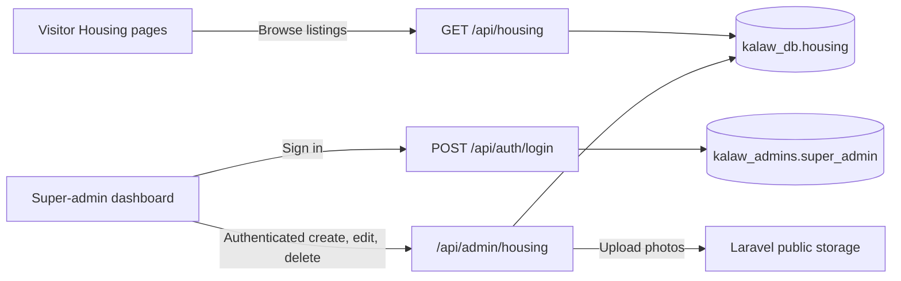

# Database developer guide

The Laravel API uses two MariaDB databases. `kalaw_db` holds listings and application tables. `kalaw_admins` holds the super-admin accounts that authorize dashboard writes. [Table purposes, usage, and relationships](DATABASE_TABLES.md) · [Schema diagram and column reference](DATABASE_SCHEMA.md)

## How Housing data moves



One listing can have several contacts and photos. Both child tables reference `housing.id` and use `ON DELETE CASCADE`. The API stores each photo's path in `housing_images.path` and serves the file under `/storage/`. [Housing controller](../backend/app/Http/Controllers/Api/HousingController.php)

## Keep the documentation current

Local Laravel migrations and rollbacks refresh both the table guide and the diagram. To pick up changes made directly in MySQL Workbench or another SQL client, keep the Laravel scheduler running in a terminal. It checks both schemas once a minute and writes each file only when its content changes.

```sh
php backend/artisan schedule:work
```

For an immediate refresh from the repository root, run `php backend/artisan db:diagram`. Commit the updated `docs/DATABASE_TABLES.md` and `docs/DATABASE_SCHEMA.md` with the migration.

When creating a table, describe what one row represents and which feature uses it in the **table comment**. In a Laravel migration, for example, use `$table->comment('One saved itinerary per trip. The itinerary editor creates and updates it.');` inside `Schema::create`. In Workbench, use the table editor’s **Comments** field. The next refresh includes the table, its comment, and its foreign keys. A table without a description appears with “Business purpose pending” and its primary key information.

For longer descriptions and application-managed relationships, edit the entries for the application or administration connection in the [table guide configuration](../backend/config/table_guide.php). These descriptions take precedence over table comments. The inventory follows the actual local database, so older volumes can also show the legacy `personal_access_tokens` table.

## Local setup

Copy `backend/.env.example` to `backend/.env` for a fresh setup. Set `DB_PASSWORD` for the `admin` database user and choose a separate `MARIADB_ROOT_PASSWORD`. Compose initializes `kalaw_db` and `kalaw_admins` in a new volume and grants the application user access to both. Laravel migrations create the super-admin account table in `kalaw_admins`.

With Docker running, execute these commands from the repository root.

```sh
docker compose --env-file backend/.env up -d --wait mariadb
php backend/artisan migrate --no-interaction
```

Laravel connects to `127.0.0.1:3307`. The [testing page](http://127.0.0.1:5173/testing/) checks the configured connection when the public frontend and Laravel are running.
