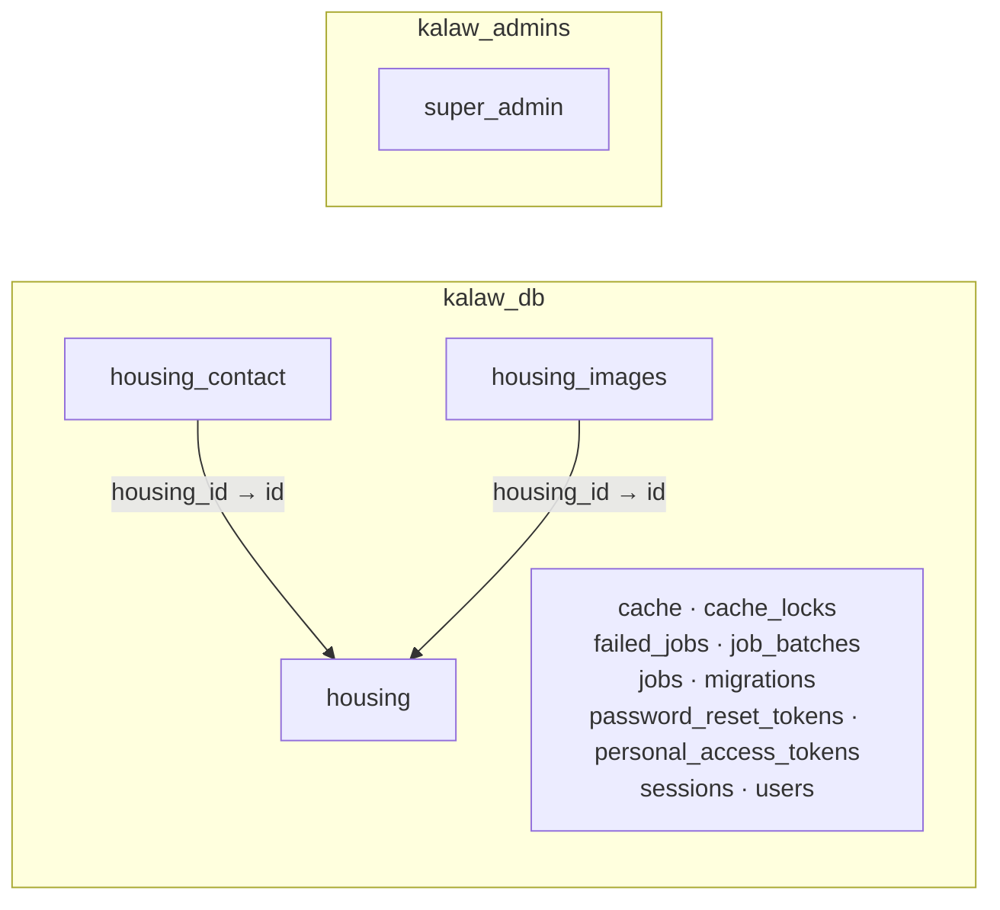

# Database schema

Generated from MariaDB metadata. [Table purposes and relationships](DATABASE_TABLES.md) · [Application flow and refresh instructions](DATABASE.md)

## Table map

Each group is a database. An arrow points from a foreign key to its referenced column. Tables without declared relationships share a box.

PK = primary key. FK = foreign key.

## `kalaw_db` · 13 tables

### `cache`

| Column | SQL type | Nullable | Key |
| --- | --- | --- | --- |
| `key` | `varchar(255)` | No | PK |
| `value` | `mediumtext` | No |  |
| `expiration` | `bigint(20)` | No |  |

### `cache_locks`

| Column | SQL type | Nullable | Key |
| --- | --- | --- | --- |
| `key` | `varchar(255)` | No | PK |
| `owner` | `varchar(255)` | No |  |
| `expiration` | `bigint(20)` | No |  |

### `failed_jobs`

| Column | SQL type | Nullable | Key |
| --- | --- | --- | --- |
| `id` | `bigint(20) unsigned` | No | PK |
| `uuid` | `varchar(255)` | No |  |
| `connection` | `varchar(255)` | No |  |
| `queue` | `varchar(255)` | No |  |
| `payload` | `longtext` | No |  |
| `exception` | `longtext` | No |  |
| `failed_at` | `timestamp` | No |  |

### `housing`

| Column | SQL type | Nullable | Key |
| --- | --- | --- | --- |
| `id` | `bigint(20) unsigned` | No | PK |
| `title` | `varchar(255)` | No |  |
| `area` | `varchar(255)` | No |  |
| `price` | `varchar(255)` | Yes |  |
| `description` | `text` | Yes |  |
| `purpose` | `varchar(20)` | Yes |  |
| `type` | `varchar(30)` | Yes |  |
| `availability` | `varchar(20)` | Yes |  |
| `created_at` | `timestamp` | Yes |  |
| `updated_at` | `timestamp` | Yes |  |

### `housing_contact`

| Column | SQL type | Nullable | Key |
| --- | --- | --- | --- |
| `id` | `bigint(20) unsigned` | No | PK |
| `housing_id` | `bigint(20) unsigned` | No | FK |
| `name` | `varchar(255)` | No |  |
| `phonenumber` | `varchar(50)` | No |  |
| `address` | `varchar(500)` | Yes |  |
| `created_at` | `timestamp` | Yes |  |
| `updated_at` | `timestamp` | Yes |  |

`housing_id` → `kalaw_db.housing (id)` · ON DELETE CASCADE

### `housing_images`

| Column | SQL type | Nullable | Key |
| --- | --- | --- | --- |
| `id` | `bigint(20) unsigned` | No | PK |
| `housing_id` | `bigint(20) unsigned` | No | FK |
| `path` | `varchar(255)` | No |  |
| `created_at` | `timestamp` | Yes |  |
| `updated_at` | `timestamp` | Yes |  |

`housing_id` → `kalaw_db.housing (id)` · ON DELETE CASCADE

### `job_batches`

| Column | SQL type | Nullable | Key |
| --- | --- | --- | --- |
| `id` | `varchar(255)` | No | PK |
| `name` | `varchar(255)` | No |  |
| `total_jobs` | `int(11)` | No |  |
| `pending_jobs` | `int(11)` | No |  |
| `failed_jobs` | `int(11)` | No |  |
| `failed_job_ids` | `longtext` | No |  |
| `options` | `mediumtext` | Yes |  |
| `cancelled_at` | `int(11)` | Yes |  |
| `created_at` | `int(11)` | No |  |
| `finished_at` | `int(11)` | Yes |  |

### `jobs`

| Column | SQL type | Nullable | Key |
| --- | --- | --- | --- |
| `id` | `bigint(20) unsigned` | No | PK |
| `queue` | `varchar(255)` | No |  |
| `payload` | `longtext` | No |  |
| `attempts` | `smallint(5) unsigned` | No |  |
| `reserved_at` | `int(10) unsigned` | Yes |  |
| `available_at` | `int(10) unsigned` | No |  |
| `created_at` | `int(10) unsigned` | No |  |

### `migrations`

| Column | SQL type | Nullable | Key |
| --- | --- | --- | --- |
| `id` | `int(10) unsigned` | No | PK |
| `migration` | `varchar(255)` | No |  |
| `batch` | `int(11)` | No |  |

### `password_reset_tokens`

| Column | SQL type | Nullable | Key |
| --- | --- | --- | --- |
| `email` | `varchar(255)` | No | PK |
| `token` | `varchar(255)` | No |  |
| `created_at` | `timestamp` | Yes |  |

### `personal_access_tokens`

| Column | SQL type | Nullable | Key |
| --- | --- | --- | --- |
| `id` | `bigint(20) unsigned` | No | PK |
| `tokenable_type` | `varchar(255)` | No |  |
| `tokenable_id` | `bigint(20) unsigned` | No |  |
| `name` | `text` | No |  |
| `token` | `varchar(64)` | No |  |
| `abilities` | `text` | Yes |  |
| `last_used_at` | `timestamp` | Yes |  |
| `expires_at` | `timestamp` | Yes |  |
| `created_at` | `timestamp` | Yes |  |
| `updated_at` | `timestamp` | Yes |  |

### `sessions`

| Column | SQL type | Nullable | Key |
| --- | --- | --- | --- |
| `id` | `varchar(255)` | No | PK |
| `user_id` | `bigint(20) unsigned` | Yes |  |
| `ip_address` | `varchar(45)` | Yes |  |
| `user_agent` | `text` | Yes |  |
| `payload` | `longtext` | No |  |
| `last_activity` | `int(11)` | No |  |

### `users`

| Column | SQL type | Nullable | Key |
| --- | --- | --- | --- |
| `id` | `bigint(20) unsigned` | No | PK |
| `name` | `varchar(255)` | No |  |
| `email` | `varchar(255)` | No |  |
| `email_verified_at` | `timestamp` | Yes |  |
| `password` | `varchar(255)` | No |  |
| `remember_token` | `varchar(100)` | Yes |  |
| `created_at` | `timestamp` | Yes |  |
| `updated_at` | `timestamp` | Yes |  |
| `role` | `varchar(255)` | No |  |

## `kalaw_admins` · 1 table

### `super_admin`

| Column | SQL type | Nullable | Key |
| --- | --- | --- | --- |
| `id` | `bigint(20) unsigned` | No | PK |
| `username` | `varchar(64)` | No |  |
| `password` | `varchar(255)` | No |  |
| `managed_by_env` | `tinyint(1)` | Yes |  |
| `remember_token` | `varchar(100)` | Yes |  |
| `created_at` | `timestamp` | Yes |  |
| `updated_at` | `timestamp` | Yes |  |
